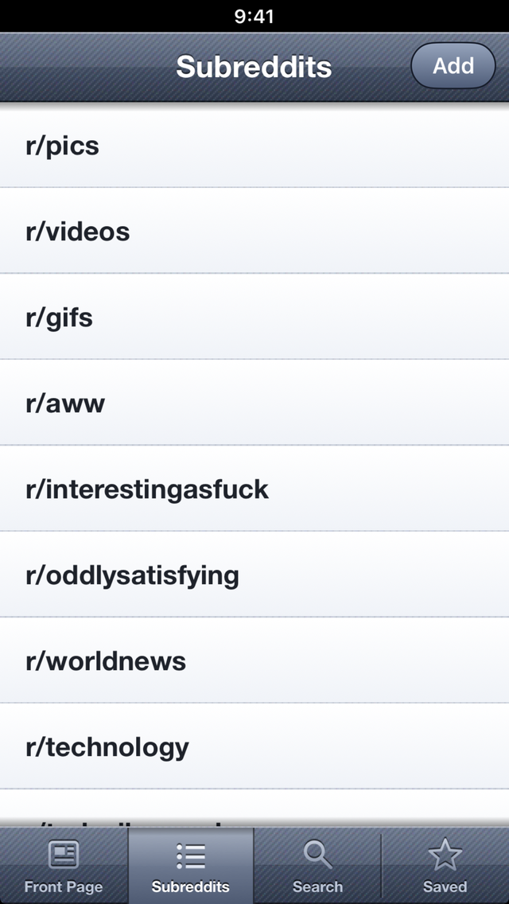

# RedditReader

A Reddit reader for iPhones that are stuck on iOS 6, with the look of that era: slate navigation bar, leather tab bar, glossy controls.
It reads Reddit's public, logged-out Atom feeds, so there is no account, no API key and no login. Pictures, animated GIFs and Reddit-hosted videos open in the app.
Everything is drawn in code; there are no image assets besides the icon and launch images.

*Screenshot from the iOS 26 simulator build. Feeds are not shown here because the posts are other people's pictures.*

## Why this exists

An iPhone 5 on iOS 6.1.3 still has a perfectly good screen and CPU, but its system TLS only trusts 2013-era root certificates and offers
older cipher suites, so most of today's websites fail the handshake or the certificate check. RedditReader therefore carries its own TLS 1.2 client
(built on [Mbed TLS](https://github.com/Mbed-TLS/mbedtls), with a bundled Mozilla root certificate list) and routes every `https://` request of the app through it.
Certificates and host names are verified.

## Features

- Four tabs: **Front Page** (r/popular), **Subreddits** (your list; add, remove, open any subreddit by name), **Search** (all of Reddit) and **Saved**.
- Sort a feed by **Hot / New / Rising / Top** (Top is the best of the last day). Pull down to refresh; further pages load when you reach the end of the list.
- Posts are classified from their link: pictures, animated GIFs (including imgur `.gifv`), Reddit-hosted video (`v.redd.it`), galleries and plain links.
  Pictures are decoded at a limited size so large photos do not exhaust the iPhone 5's memory.
- **Viewer** for pictures and GIFs: pinch and double-tap to zoom, drag to look around, **Save** puts the original file in the photo library.
- **Video**: `v.redd.it` serves video and audio as separate fragmented MP4 (DASH) files that iOS 6's player cannot open. The app downloads both, joins them
  into one ordinary MP4 with its own small muxer (`src/RRMux.c`), caches the result and plays it with the system player.
- Post page with the text and the comments as cards. Comments come from one request for the thread, sorted by Top (up to 100). Posts that link to a web page open it in a simple in-app web view.
- Star a post to save it on the device; the Saved list works without a network (swipe a row to remove it).
- Requests go through one queue that respects Reddit's rate limit (see below) and the answers are cached on disk for a while.

## Download

Every push to `main` is built by GitHub Actions. Get the unsigned IPA from the [Releases page](../../releases):

- [latest versioned release](../../releases/latest) - the stable one (versions follow [Semantic Versioning](https://semver.org/), see [CHANGELOG.md](CHANGELOG.md));
- the [`nightly` pre-release](../../releases/tag/nightly) - the newest build of `main`, replaced on every push.

The IPA is unsigned: install it on an iOS 6 device that has AppSync Unified, e.g. `ideviceinstaller -i RedditReader-<version>.ipa`. A `.sha256` file sits next to each IPA.

## Requirements

- To run it: an iOS 6 device (written and tried on an iPhone 5 with iOS 6.1.3) that can install unsigned apps, i.e. jailbroken with
  [AppSync Unified](https://github.com/akemin-dayo/AppSync) installed. Or just use the simulator build on a Mac.
- To build it: a Mac with Xcode and its command line tools (developed with Xcode 26). Current Xcode cannot target iOS 6 by itself, so the device build links against the public
  iOS 9.3 SDK stubs, which `tools/setup-sdk.sh` downloads and patches (see below).
- Optional: Python 3 with Pillow to regenerate the icon and launch images (`make_assets.py`); `ffmpeg` with libx264 for the extra end-to-end video test.

## Build and install

    tools/setup-sdk.sh                       # once: fetches and patches the iOS 9.3 SDK stubs into ./.sdk (git-ignored)
    export SDK93="$PWD/.sdk/iPhoneOS9.3.sdk"
    ./build.sh device                        # -> build/RedditReader.ipa (armv7, iOS 6.0 minimum, unsigned)
    ideviceinstaller -i build/RedditReader.ipa   # from libimobiledevice; the phone needs AppSync

`./build.sh sim` builds an arm64 simulator app, `build/sim/RedditReader.app`, with the preview hooks below:

    xcrun simctl install booted build/sim/RedditReader.app
    xcrun simctl launch booted com.savrum.redditreader

The Objective-C files are compiled with ARC (`-fobjc-arc`) but linked without it, because current Xcode has no `libarclite` for iOS 6 and the iOS 6 runtime
already contains the ARC entry points the code uses. The libraries are linked with `-undefined dynamic_lookup` against the SDK stubs.

## Simulator preview hooks

Only the simulator build (`-DRR_PREVIEW`) reads these environment variables; pass them with `SIMCTL_CHILD_<NAME>=value xcrun simctl launch ...`.

| Variable | Effect |
|---|---|
| `RR_TAB` | Start on tab 0 Front Page, 1 Subreddits, 2 Search, 3 Saved |
| `RR_SUB` | Open this subreddit (by name, without `r/`) on start |
| `RR_OPEN` | Open the nth post of the first list that loads |
| `RR_PLAY` | With `RR_OPEN` on a video post: start the video after a second |

## Tests

    tests/run.sh

Builds natively on the Mac and runs:

- `tests/mux_test.c` - the MP4 joiner (`src/RRMux.c`) on small synthetic fragmented files;
- `tests/feed_test.m` - Atom feed parsing, post classification, subreddit-name cleaning and the text helpers (Foundation only; UIKit is shimmed);
- if `ffmpeg` with libx264 is installed, an end-to-end check: real H.264 + AAC fragmented files are joined with `tools/mux_cli.c` and the result must decode with the expected number of frames.

The UI, the TLS layer and the networking are not covered by automated tests; CI builds the simulator and device targets.

## Project layout

| File | Purpose |
|---|---|
| `src/main.m` | App delegate; installs the TLS protocol, creates the root controller, preview hooks |
| `src/RRFeed.{h,m}` | Atom feed client (posts, search, comments) with the request queue, rate-limit handling and disk cache; post classification; the Saved and Subreddits lists in `NSUserDefaults` |
| `src/RRMedia.{h,m}` | Picture and GIF download, cache and size-limited decoding; the video pipeline (DASH manifest, downloads, mux) |
| `src/RRMux.{h,c}` | Joins fragmented video and audio MP4 files into one MP4 with a normal sample table |
| `src/RRChrome.{h,m}` | Custom navigation bar, back button, segmented control, leather tab bar and the small navigation stack (`RRRootController`) |
| `src/RRListController.{h,m}` | A feed, search result or the Saved list as post cards; sorting; inline media |
| `src/RRPostController.{h,m}` | A post: text, media and the comment cards |
| `src/RRSubsController.{h,m}` | The Subreddits and Search tabs |
| `src/RRViewer.{h,m}` | Full-screen picture viewer with zoom and Save |
| `src/RRPrompt.{h,m}` | In-app replacement for `UIAlertView` (some jailbreak tweaks swallow alert views) |
| `src/RRStyle.{h,m}`, `src/RRText.m` | Drawing helpers and Foundation-only text helpers (relative time, HTML to plain text) |
| `src/HNSecureProtocol.{h,m}` | `NSURLProtocol` that sends every https request through the bundled TLS: HTTP/1.1 with chunked bodies, redirects, cookies |
| `src/HNTLS.{h,c}` | The TLS 1.2 client itself (mbedTLS, root certificates, timeouts, cancel). The `HN` prefix is historical: this layer started in a Hacker News reader by the same author |
| `third_party/` | mbedTLS and its configuration, see `third_party/README.md` |
| `res/` | App icon, launch images, `cacert.pem` |
| `make_assets.py` | Draws the icon and launch images |
| `tools/` | `setup-sdk.sh` (iOS 9.3 SDK stubs) and `mux_cli.c` (command-line front end of the muxer) |
| `tests/` | Native tests |

## Reddit's rate limit, and being a good citizen

Without an API key Reddit allows roughly one request per 40 seconds to its feeds, and says so in `x-ratelimit-*` response headers.
RedditReader sends every feed request through one queue, waits for the reset time Reddit reports before the next request, caches answers on disk (10 minutes for
lists, 15 minutes for comments, an hour for further pages) and tells you when it is waiting ("Next one in 23 s"). It identifies itself with its own `User-Agent`
(`ios6-reddit-reader/1.0 (personal use, atom feeds)`), not as a browser.

This is a client for personal, low-volume reading. It does not and should not try to get around the limit: please do not remove the queue, and if you change the request
pattern, read [Reddit's Data API terms](https://redditinc.com/policies/data-api-terms) first. Pictures and videos come from the hosting servers
(`i.redd.it`, `v.redd.it`, `i.imgur.com` and so on) and are not subject to the feed limit.

## Network and privacy

There are no accounts, analytics or trackers. The app contacts:

- `www.reddit.com` (HTTPS) for feeds, search and comment threads;
- the media hosts of the posts you open: `i.redd.it`, `preview.redd.it`, `v.redd.it`, `i.imgur.com` and other image hosts that posts link to;
- the web page of a link post, only when you open it (shown in an in-app web view, loaded through the same bundled TLS).

On the device the app stores your subreddit list and the saved posts (title, link, author, text) in its preferences, and caches feeds, pictures and joined videos in
its `Library/Caches` folder (swept when over a size budget). Nothing is sent anywhere else. Requests carry no cookies from you because there is no login.

## Status and limitations

- Developed and tried on one iPhone 5 running iOS 6.1.3, plus the iOS 26 simulator. Other iOS 6 devices should work but are untested.
- Read-only: no login, voting, commenting or posting. NSFW and quarantined content is whatever Reddit serves to logged-out clients.
- Comments come from the thread's feed: flat cards sorted by Top, at most 100, without the reply tree.
- The TLS client supports TLS 1.2 only (no TLS 1.3), no session resumption, no HTTP/2, no compression.
- Reddit changes its feeds and video hosting from time to time; a change there can break post classification or video playback until the code is adjusted.
- The bundled root certificates age; refresh `res/cacert.pem` now and then (see `third_party/README.md`).

## Not affiliated

RedditReader is an independent project. It is not affiliated with, endorsed by or sponsored by Reddit, Inc. "Reddit" is a trademark of Reddit, Inc.
and is used here only to say which service the app reads. The icon is an original drawing.

## Contributing

See [CONTRIBUTING.md](CONTRIBUTING.md). Issues and pull requests are welcome, keeping in mind that the target is iOS 6.

## License

[MIT](LICENSE) for the code in this repository. Third-party components are listed in [THIRD_PARTY_NOTICES.md](THIRD_PARTY_NOTICES.md).
